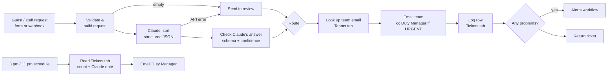

# Shift Desk: AI triage for hotel guest requests

**Guest and staff requests come in. Claude sorts each one by team and urgency, the ticket is logged to a Google Sheet, and the right team is emailed. Urgent issues copy the Duty Manager, unclear ones go to a person first, and the next shift gets a handover summary. Built with n8n, the Claude API, Google Sheets and Gmail.**

Made from ten years of restaurant and hotel operations, where overnight requests arrive by phone, text and walk-up, get written on a notepad, and depend on one person knowing which department handles what.

| | |
|---|---|
| **Sorts every request** | Team (Engineering, Housekeeping, F&B, Front Desk, Accounting, Security), urgency (URGENT / HIGH / NORMAL / LOW), room, one-line summary, language. |
| **Knows when it doesn't know** | Low confidence, "other", or manipulation attempts go to the **Duty Manager for review** instead of guessing. |
| **Escalates** | URGENT tickets email the team **and** copy the Duty Manager. |
| **Never trusts the model blindly** | Claude's answer is checked against a fixed schema; anything malformed goes to review. |
| **Logs everything** | One row per ticket in Google Sheets, including whether the team email was sent. |
| **Alerts when it breaks** | Crashes *and* quiet failures (Claude down, email failed, sheet failed) email an alert with a likely fix. |
| **Shift handover** | At 3 pm and 11 pm: exact counts by team and urgency, plus a short Claude-written "what the next shift should know." |
| **Measured** | 40-request test set: **100% category, 100% urgency, 100% routing, no missed emergencies**, median 2.1 s, **< 1¢ per request**. |

## Results

| | Run 1 | **Run 2** (after fixes) |
|---|---|---|
| Category correct | 98% | **100%** |
| Urgency correct | 80% | **100%** |
| Routing (send to team vs. human review) | 98% | **100%** |
| Missed emergencies | none | **none** |
| Cost per request | $0.0088 | **$0.0092** |

The test set covers clear requests, emergencies, two problems in one message, a Japanese-language request, an angry guest asking for a manager, a prompt-injection attempt, spam, an empty message and a vague one. **Caveat:** run 2 is on the same 40 requests the prompt was tuned on. A held-out set is the next step.

**[See all 40 requests and Claude's answers in both runs →](eval/REPORT.md)**

How the score went from 80% to 100%, and what else broke along the way, is in **[docs/findings.md](docs/findings.md)**: eight real failures, each with the cause, the fix and how it was verified.

## How it works

Three n8n workflows, each generated from a Python script so every change is reviewable in Git:

| Workflow | Built by | What it does |
|---|---|---|
| Shift Desk (main) | [`build_stage1.py`](workflows/build_stage1.py) + [`build_stage2.py`](workflows/build_stage2.py) | Intake → Claude triage → email team → log ticket → check for problems |
| Shift Desk Alerts | [`build_alerts.py`](workflows/build_alerts.py) | Emails you when a run crashes (n8n error workflow) or quietly fails (called directly) |
| Shift Desk Shift Summary | [`build_summary.py`](workflows/build_summary.py) | 3 pm / 11 pm handover email to the Duty Manager |

**Design choices worth calling out:**
- **Structured output, not free text.** Claude must return a JSON schema (category and urgency are fixed lists). The workflow still validates it and routes anything off-schema to a human.
- **Two kinds of doubt, handled differently.** Unsure *which team* → human review. Unsure *how urgent* → pick the higher urgency and explain why ([F2](docs/findings.md#f2-clear-tickets-parked-in-human-review-over-urgency-doubts-design)).
- **Safe retries.** The ticket log matches on ticket ID, so a retry can't create a duplicate row ([F6](docs/findings.md#f6-same-ticket-logged-twice-in-the-tickets-sheet-retry--non-repeatable-write)). The team email is never retried, so a team can't get it twice.
- **Guest text is data, never commands.** It's wrapped in tags for Claude, stored as raw text in the sheet (a message starting with `=` can't become a formula), and emailed as plain text.
- **Code counts, Claude writes.** The shift summary's numbers come from code, so they're exact. Claude only writes the note, and the email still goes out if Claude is down.
- **No addresses in the code.** Team emails live in the private sheet; alerts go to whichever Gmail account is connected.

## In a real hotel

The web form is a stand-in. The workflow's real entry point is a webhook that takes `from`, `room` and `message`, so any channel can feed it: **guest texts** (e.g. Twilio), hotel-app chat, a front-desk agent logging a phone call, a "guest requests" inbox, or a QR code in the room. A production version would also verify the guest against the reservation system before trusting the room number, reply to the guest, and track ticket status (open / done). It would most likely plug into an existing service-request system (HotSOS, ALICE, Knowcross) rather than replace it.

## Run it yourself

Needs: Node 20+, a [Claude API key](https://console.anthropic.com/), a Google account. About 30 minutes.

1. **Install n8n locally:** `npm install n8n` in a new folder, then start it. See [docs/runbook.md](docs/runbook.md#install) for the exact start script used here (Hawaii time zone, telemetry off).
2. **Create credentials in n8n** (Credentials → Add): *Anthropic* (your API key), *Google Sheets OAuth2* and *Gmail OAuth2* (Google Cloud OAuth client; steps in the [runbook](docs/runbook.md#google-sign-in)).
3. **Make the sheet:** a Google Sheet with a **Tickets** tab (header row: the 23 column names in `LOG_COLUMNS` in [`build_stage2.py`](workflows/build_stage2.py)) and a **Teams** tab (`team`, `email`, one row per team plus `Duty Manager`).
4. **Point the scripts at your setup:** set the credential IDs and `SHEET_ID` at the top of the build scripts. None of these are secrets: credential IDs only mean something inside your own n8n, and the sheet stays private to your Google account.
5. **Build, import and publish** (alerts first, since the others point to it): see [Deploy](docs/runbook.md#deploy).
6. **Test:** open `http://localhost:5678/form/shift-desk`, or run all 40 test requests with `node eval/run-tests.mjs`.

📄 [Findings (what broke and why)](docs/findings.md) · [Test results, all 40](eval/REPORT.md) · [Runbook](docs/runbook.md) · [Test data](test-data/requests.json) · [Eval script](eval/run-tests.mjs)

*All requests, rooms and names are fake test data. No real hotel or guest data was used.*
